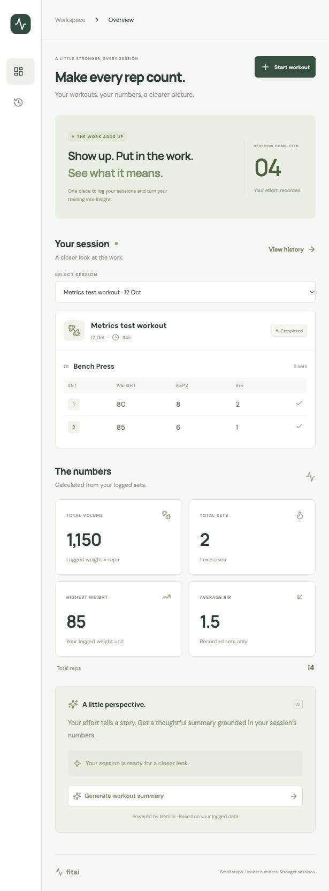
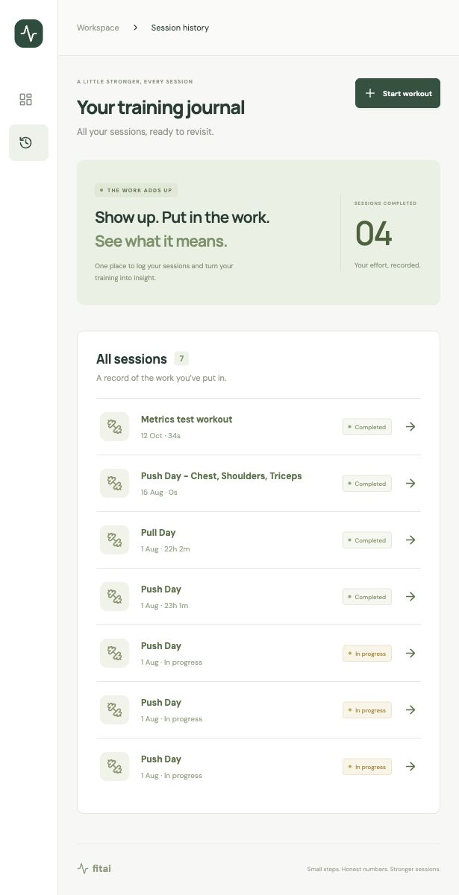
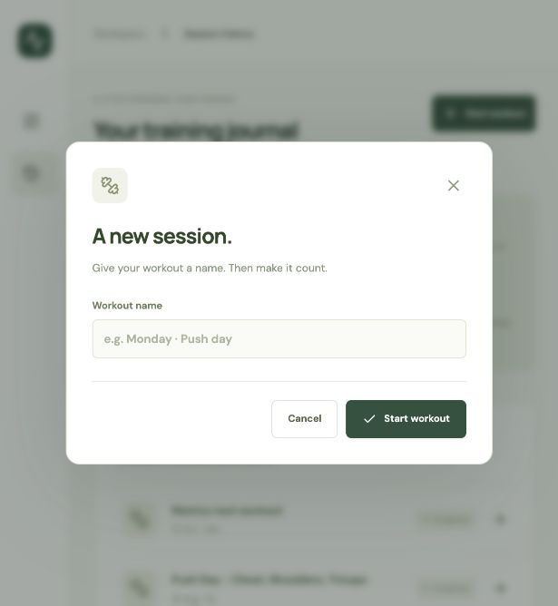

# FitAI

AI-powered workout tracking platform.

## Features

- React workout workspace and session history
- Workout, exercise, and set logging
- Backend-calculated workout and exercise metrics
- Structured AI workout summaries with Google Gemini
- Kafka event streaming

## Tech Stack

- Java 21
- Spring Boot
- Kafka
- PostgreSQL
- React + TypeScript + Vite
- Docker

## Workout metrics

`GET /api/workouts/{workoutId}/metrics` returns current metrics for an existing
workout, including in-progress workouts. Unknown workout IDs return 404.

- Workout and exercise totals: sets, reps, volume, highest weight, average RIR.
- Volume is the sum of `weight × reps`, using the logged weight unit. It does
  not estimate bodyweight load or account for unilateral/dumbbell multipliers.
- Average RIR includes only recorded values and weights each set equally.
- Empty workouts have zero totals. Highest weight and average RIR are `null`
  when there are no relevant recorded values.

Completed-workout AI summaries receive these backend-computed metrics alongside
the raw sets. No metrics are persisted; they reflect the current workout data.

## Architecture

React + TypeScript frontend → Spring Boot REST API → PostgreSQL.
Kafka handles workout events, and Gemini generates summaries using verified
workout metrics. The backend is organized as a modular monolith.

## Frontend

The React app lives in [`frontend/`](frontend/README.md). Run `pnpm install`
and `pnpm dev` in that directory, with the backend running on port 8080.
Open http://127.0.0.1:5173 to log workouts, view metrics, and request AI summaries.

## Screenshots

Captured from the running React frontend using the local test workouts.

<table>
  <tr>
    <th>Workout workspace and metrics</th>
    <th>Session history</th>
    <th>Start a workout</th>
  </tr>
  <tr>
    <td valign="top"></td>
    <td valign="top"></td>
    <td valign="top"></td>
  </tr>
</table>

Select a screenshot to view it at full size.
