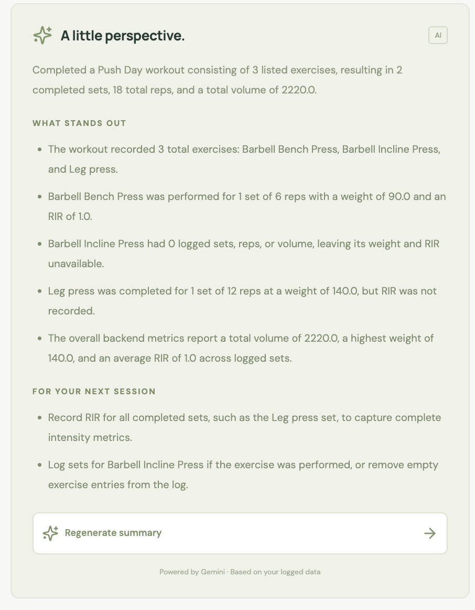

# FitAI

AI-powered workout tracking platform.

## Features

- React workout workspace and session history
- Workout, exercise, and set logging
- Backend-calculated workout and exercise metrics
- Structured AI workout summaries retrieved from Google Gemini File Search
- Kafka-driven indexing of completed workouts for the fixed user `user1`
- Kafka event streaming

## Tech Stack

- Java 21
- Spring Boot
- Kafka
- PostgreSQL
- React + TypeScript + Vite
- Docker

## Workout metrics

`GET /api/workouts/{workoutId}/metrics` returns current metrics for an existing
workout, including in-progress workouts. Unknown workout IDs return 404.

- Workout and exercise totals: sets, reps, volume, highest weight, average RIR.
- Volume is the sum of `weight × reps`, using the logged weight unit. It does
  not estimate bodyweight load or account for unilateral/dumbbell multipliers.
- Average RIR includes only recorded values and weights each set equally.
- Empty workouts have zero totals. Highest weight and average RIR are `null`
  when there are no relevant recorded values.

Metrics are calculated on demand from PostgreSQL. When a workout is completed,
a Kafka consumer uploads a document containing the raw sets and verified metrics
to Gemini File Search. Summary requests retrieve stored documents instead of
embedding the workout or its full history in every generation prompt.

## Architecture

React + TypeScript frontend → Spring Boot REST API → PostgreSQL.
Kafka handles workout events, and Gemini generates summaries using verified
workout metrics. The backend is organized as a modular monolith.

## Workout indexing and AI summaries

This version uses a fixed backend identity, `user1`. Completing a workout saves
an indexing job in PostgreSQL. A scheduled dispatcher publishes it through Kafka,
and a consumer uploads a dated, user-tagged document to Gemini File Search.
The frontend shows preparation status until the document is ready.

For older completed workouts, choose **Prepare workout insights**, or call
`POST /api/workouts/{id}/index`. Read status at `GET /api/workouts/{id}/index`.
Summary generation retrieves user1's relevant stored documents through File Search.

See [the indexing flow and setup](docs/workout-indexing.md) for configuration,
retry behavior, migration of existing workouts, and current limitations.

## Frontend

The React app lives in [`frontend/`](frontend/README.md). Run `npm install`
and `npm run dev` in that directory, with the backend running on port 8080.
Open http://127.0.0.1:5173 to log workouts, view metrics, and request AI summaries.

## Screenshots

Captured from the running React frontend using the local test workouts.

<table>
  <tr>
    <th>Workout workspace and metrics</th>
    <th>Session history</th>
    <th>Start a workout</th>
  </tr>
  <tr>
    <td valign="top"></td>
    <td valign="top"></td>
    <td valign="top"></td>
  </tr>
</table>

Select a screenshot to view it at full size.

### AI workout summary

Gemini interprets the logged workout and backend-calculated metrics to provide
a summary, observations, and suggestions for the next session.

